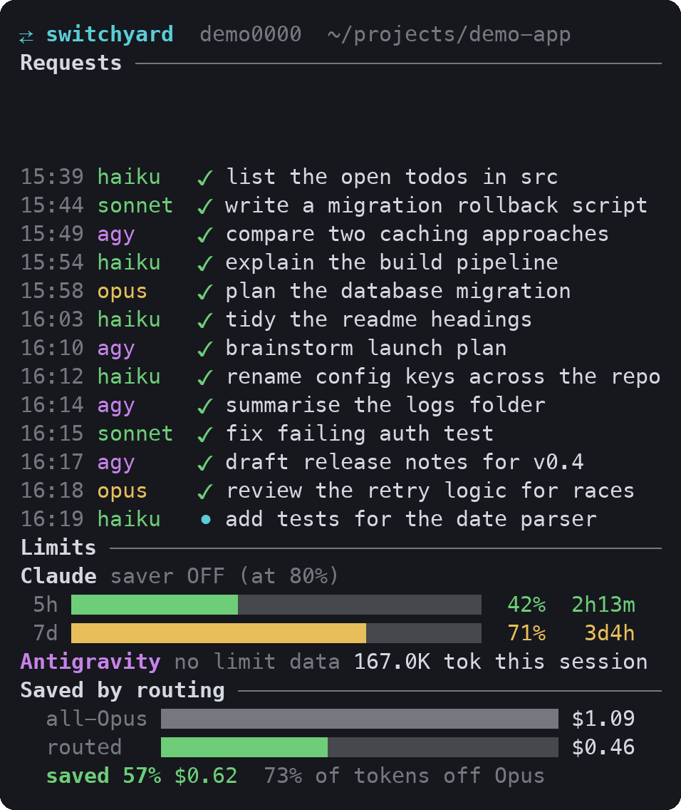
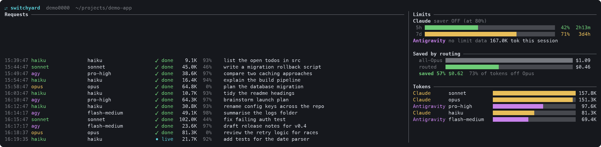

# switchyard

Model routing for people who pay for **subscriptions**, not per-token API access. You chat in the
normal Claude Code TUI. Each request goes to the cheapest model that can do it: a Haiku, Sonnet
or Opus subagent, or your Antigravity CLI (Gemini Flash, Gemini Argon, or the Claude models on
that plan). You never pick the model yourself.

> switchyard is a community launcher that runs Claude Code and the Antigravity CLI. It is not made by,
> affiliated with, or endorsed by Anthropic or Google.

## ⚠️ It runs in yolo mode by default

`cr` starts Claude Code with `--dangerously-skip-permissions`, and agy hand-offs run with
agy's `--dangerously-skip-permissions`. Commands and edits run without asking you first.
Your hooks still run. Use `cr --safe` (or `CR_SAFE=1`) to get permission prompts back, which
also makes agy hand-offs run in `accept-edits` mode.

## Install

```sh
git clone https://github.com/nbaker47/switchyard && cd switchyard && ./install.sh
```

It needs [Claude Code](https://code.claude.com), signed in with your own plan. The
[Antigravity CLI](https://antigravity.google) (`agy`) is optional and also needs your own
login. Python 3.9+ and nothing else.

## Use

```sh
cr                       # chat, with routing (any claude flag works: cr -c, cr -p "...", ...)
cr --safe                # same, with permission prompts
cr models                # what your agy plan offers, and what each tier resolves to
cr agy --tier fast "..." # hand a task to agy yourself
cr usage [--days 7]      # tokens per subscription and model, and the routes taken
cr route                 # what the front desk is told right now: saver mode, quota, agy tiers
cr dash                  # live dashboard for a side pane
cr report --json         # everything above as JSON, for your own dashboards (versioned schema)
```

## Dashboard

`cr dash` is a live terminal dashboard for a side pane. Narrow panes stack everything in one
column; wide terminals put the feed on the left and the panels on the right.





Run `cr dash` in a split pane next to `cr`. It shows three things: live requests (what each
prompt was routed to, its tokens and how much it saved), provider limits (your 5-hour and 7-day
Claude windows and saver mode, plus an Antigravity bar per quota pool when the
`antigravity-usage` CLI is installed), and saved by routing (what the same work would have cost on
Opus alone). The screenshots use sample data (`cr dash --demo`); regenerate them with
`python3 scripts/render_dash_images.py`.

## Project context for agy

`cr agy` prepends the project context Claude Code would have loaded to the task, under a
`## Task` header: every `CLAUDE.md` (and `CLAUDE.local.md`) from `~/.claude` and from the
filesystem root down to the current directory, inlined, with simple `@path` import lines
followed; a list of all skills (name, description, path, plus reference `.md` files) from
`~/.claude/skills` and each `.claude/skills` on that path, which agy reads itself; and the
project's `~/.claude/projects/<cwd with / as ->/memory/MEMORY.md` index. Nothing is added
when there are no `CLAUDE.md` files and no skills. A line such as
`context: 3 CLAUDE.md, 41 skills, ~9.2k tokens (chars/4)` shows what it costs.

- `--bare` or `CR_AGY_BARE=1` skips the preamble.
- `--full-context` or `CR_AGY_FULL_CONTEXT=1` disables the Caveman/TOON markdown compressor and task-matched skill filter.
- `--show-context [--compress]` prints the preamble (raw or compressed) and exits without calling agy.
- `CR_AGY_CONTEXT_MAX_CHARS` (default `120000`): above it, the largest `CLAUDE.md` files are
  replaced by a path pointer, and the preamble says so.

## Seeing the routing (Live Dynamic Flow Graph)

- **In the chat (`UserPromptSubmit` → `PreToolUse` → `cr agy` → `PostToolUse`):**
  1. **Prompt Intake:** `⇄ reading request ──► [haiku desk] · ⛽ pace saver (...) · ctx 14K · Claude 47% │ Agy Cl 62%·Ge 3% ⚡ shift→Gemini`
  2. **Route Dispatch (`PreToolUse`):** `╭─ ⇄ [prompt] ──► [haiku desk] ──► [Antigravity: argon-high] (remapped opus→argon-high)`
  3. **Completion & Opus Savings Box (`cr agy` & `PostToolUse`):**
     ```text
     ╭─ ⇄ switchyard flow ─────────────────────────────────────────────────────────
     │  [prompt] ──► [haiku desk] ──► [Antigravity: opus→argon-high] ──► [✓ 12.4s]
     │  model:  gemini-4-argon-high (pool shift (Agy Claude 62% vs Gemini 3%) · opus→strong)
     │  tokens: 38.2K (36.1K in, 2.1K out) · preamble −78% (28 skills pruned)
     │  saved:  💰 $0.420 saved vs pure Opus ($0.000 actual vs $0.420 Opus · −100%)
     ╰─────────────────────────────────────────────────────────────────────────────
     ```
- **Status line:** your own status line still runs first, and switchyard adds one line below it:
  `⇄ │ [haiku]──►[agy:argon-high] │ ctx 18K │ vs all-Opus −84% ($4.12 saved) │ C:5h 47%·7d 23% │ Agy:Cl 62%·Ge 3%`
- **`cr dash`:** a live view to run next to the chat. It shows the cost against an all-Opus
  session, your plan's 5-hour and 7-day quota (plus pace saver and Antigravity pool-shift status), tokens by provider and model, and a feed of requests and the routes they took.

**"Saved vs all-Opus"** prices every token that was actually processed (front desk,
subagents, agy) as if Opus had processed it, and compares that with what each model really
costs. agy work costs nothing on the Claude plan. The prices in `lib/prices.json` are API
list prices, used only as weights.

## How it works

1. **A thin Haiku front desk (`PreToolUse` enforced).** `cr` starts `claude` on Haiku
   (`CR_FRONT_MODEL` changes that) with `--autocompact 50k`. A `PreToolUse` hook (`gate.py`)
   blocks the front desk from editing files or running multi-file reads/searches in the main
   conversation, guaranteeing that real work is handed off instead of bloating context.
2. **4-Pool Quota & 7-Day Pace Balancer.** `route.py` and `lib/agy.py` track all 4 pools:
   Claude 5-hour, Claude 7-day (including projected end-of-week burn pace), Antigravity Claude,
   and Antigravity Gemini. When Antigravity's Claude pool is hotter than its Gemini pool,
   `cr agy` automatically remaps `--tier opus` and `--tier sonnet` to Gemini Argon (`strong`) /
   Flash (`fast`) unless `--force-claude` is passed.
3. **5-Layer Token Compression (Caveman + Chain-of-Draft + TOON + RTK):**
   - **Chain-of-Draft (`CoD`):** `<=5 words` per internal reasoning step.
   - **Telegraphic Wire Protocol (`TOON`):** Compact `GOAL | FILES | CONSTRAINTS | VERIFY` briefs
     and `STATUS | CHANGED | SUMMARY | VERIFY` return payloads.
   - **Caveman Preamble Compression:** Compresses `CLAUDE.md` files and prunes unrelated skills
     before sending context to `cr agy` (~70–85% smaller preamble).
   - **RTK CLI Output Compression:** Automatically wraps noisy `git`, `pytest`, `cargo`, `go test`,
     and `npm test` commands in subagents with `rtk` when installed.
4. **Routes:**

   | Route | Model | For |
   |---|---|---|
   | self | Haiku front desk | conversation, short answers already in context |
   | `switchyard:scout` | Haiku | tiny read-only lookups |
   | `cr agy --tier auto` | Auto (Flash/Argon/Sonnet/Opus) | single-hop triage + pool-balanced execution |
   | `cr agy --tier sonnet` | Sonnet / Argon / Flash (agy) | scoped changes (default; auto-shifts to Gemini when Agy Claude pool is hot) |
   | `cr agy --tier opus` | Opus / Argon (agy) | design, hard bugs, security (default; auto-shifts to Argon when Agy Claude pool is hot) |
   | `switchyard:worker` | Sonnet | browser/Claude-only tooling; fallback if agy fails |
   | `switchyard:deep` | Opus | browser/Claude-only tooling; fallback if agy fails |
   | `cr agy --tier fast` | Gemini Flash | bulk reading and mechanical work |
   | `cr agy --tier strong` | Gemini Argon | whole-repo context, pool balancing, second opinions |

## Settings

| Variable | Default | |
|---|---|---|
| `CR_FRONT_MODEL` | `haiku` | front-desk dispatcher model |
| `CR_SAFE` | `0` | `1` turns yolo mode off |
| `CR_AUTOCOMPACT` | `50k` | auto-compact threshold |
| `CR_CLEAR_AT` | `50000` | context size (tokens) at which the hook suggests `/clear` |
| `CR_SAVER_AT` | `80` | Claude plan usage (%) at which saver mode starts |
| `CR_PACE_PROJ_AT` | `105` | projected 7-day usage (%) at which pace saver starts early |
| `CR_AGY_SHIFT_AT` | `45` | Antigravity Claude pool (%) at which work shifts to Gemini Argon/Flash |
| `CR_ENFORCE_DISPATCH` | `1` | `0` disables the `PreToolUse` front-desk edit/read gate |
| `CR_NOTICE` | `1` | `0` hides the per-prompt and tool routing flow notices |

Logs live in `~/.local/state/switchyard/`: `routes.jsonl` and `agy.jsonl`.

## Tests

```sh
python3 -m unittest discover tests
```

## License

MIT
